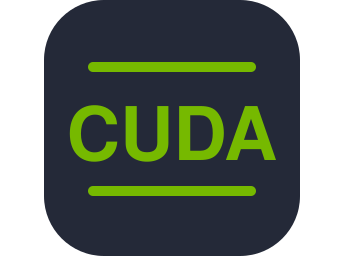

<h1 align="center">Hi, I'm Diogo Silva 👋</h1>

  

  

  

---

## About

Networking engineer by training, AI/ML engineer by choice. I build things where the two meet.

`user intent` → `telemetry` → `ML` → `services that run leaner and greener`

- **Now:** closing the loop between intent, telemetry and ML to optimise services across the edge–cloud continuum, delivering the same quality with less energy
- **Background:** routing, MPLS, overlays, Wi-Fi 6/7, 5G and SDN
- **Also into:** network security, GPU/HPC, and a homelab where I build, break and rebuild things

<b>Toolbox</b>

 

- **Networking:** BGP, MPLS, VXLAN/EVPN, 5G, Wi-Fi 6/7, SDN/NFV, P4, Wireshark, GNS3
- **ML & Data:** PyTorch, TensorFlow, XGBoost, pandas, NumPy, federated learning
- **Systems & HPC:** Python, C/C++, Rust, Java, CUDA, OpenCL, OpenMP, MPI, MATLAB
- **Security:** Suricata, Wazuh, UEBA, NetFlow, IPsec, WireGuard, 802.1X
- **Observability:** Grafana, InfluxDB, Telegraf, Prometheus, SNMP
- **Cloud-Native & DevOps:** Linux, Docker, Kubernetes, Kafka, GitHub Actions
- **Embedded & IoT:** ESP32-C6, FreeRTOS, BLE, Zigbee, LoRaWAN, MQTT

 

| Area | Technologies |
|---|---|
| **Wireless & mobile** | Wi-Fi 6/7, 5G (SBA, network slicing, 5G-AKA, MEC, O-RAN), NB-IoT, LoRaWAN, BLE, Zigbee, V2X (ITS-G5, C-V2X), 6G |
| **Routing & switching** | IPv4/IPv6, L2/L3 switching, STP, VLANs, intra- and inter-domain unicast and multicast routing, BGP/MP-BGP, route reflectors |
| **Carrier & data-centre networks** | MPLS (LDP, RSVP-TE), L3VPN/VRF, VXLAN, BGP EVPN, QoS (IntServ/DiffServ), CDNs |
| **Programmable networks** | SDN, OpenFlow, P4, NFV |
| **Network management** | SNMP, NetFlow, TMN |
| **Network security** | Zero Trust, 802.1X/EAP/RADIUS, WPA2, NGFW/DMZ, iptables/nftables, IPsec/IKE, WireGuard, PKI/X.509, Suricata, Wazuh |
| **Distributed & autonomous networks** | MANET routing (AODV, OLSR, BATMAN), P2P overlays (DHT, BitTorrent, IPFS) |
| **Core services** | TCP/UDP, DNS, DHCP, NAT, HTTP, sockets, VoIP |

---

## Stuff I've built

<table>
  <tr>
    <td width="50%" valign="top">
      <h3><a href="https://github.com/DiogoZeca/Agentic_AI">CPU Spike Predictor</a></h3>
      Forecasts datacenter CPU spikes 15–60 min ahead, so schedulers can act before they hit.
        
        
    </td>
    <td width="50%" valign="top">
      <h3><a href="https://github.com/DiogoZeca/Sensor_Project">Smart Power Fault Detection</a></h3>
      Low-power ESP32 node that catches brownouts and power loss in under a second.
        
         
    </td>
  </tr>
  <tr>
    <td width="50%" valign="top">
      <h3><a href="https://github.com/DiogoZeca/UEBAModule_SIEM">UEBA Module for SIEM</a></h3>
      Spots compromised hosts through exfiltration, DNS tunnelling and C2 beaconing in network flows.
        
        
    </td>
    <td width="50%" valign="top">
      <h3><a href="https://github.com/DiogoZeca/Autonomous_Emergency_Vehicle">Autonomous Emergency Vehicle</a></h3>
      V2X testbed that clears traffic and pre-empts signals for emergency vehicles.
        
         
    </td>
  </tr>
  <tr>
    <td width="50%" valign="top">
      <h3><a href="https://github.com/DiogoZeca/DetiCoins">DetiCoins</a></h3>
      SHA-1 miner benchmarked across SIMD, CUDA, OpenCL and MPI backends.
        
         
    </td>
    <td width="50%" valign="top">
      <h3><a href="https://github.com/DiogoZeca/Elemental_Clash">Elemental Clash</a></h3>
      3D card battle in the browser against an AI opponent. <a href="https://diogozeca.github.io/Elemental_Clash/">Play it live</a>.
        
         
    </td>
  </tr>
</table>

---

## Activity

  

